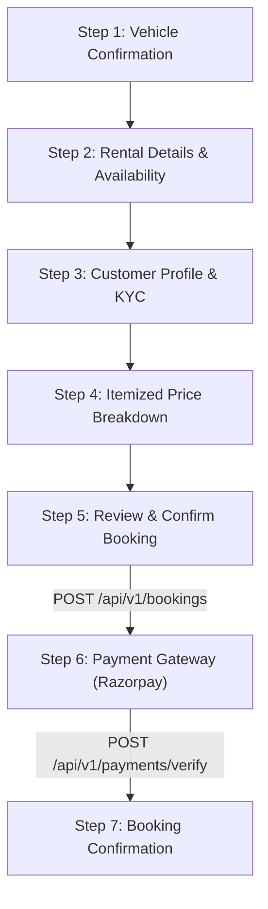

# CountryDrive – Dedicated Multi-Step Booking Flow Implementation

**Document Purpose**: Engineering specification of the dedicated multi-step booking architecture and API integration flow in `Frontend/User/`.  
**Component**: `Frontend/User/src/pages/BookingPage.jsx`  
**Routes**: `/booking/:vehicleId`, `/booking`, `/checkout` (protected by `ProtectedRoute.jsx`)

---

## 1. Overview & Architectural Motivation

Previously, vehicle reservations were handled inside `BookingModal.jsx`, an ephemeral popup modal that:
1. Truncated fields and caused vertical scrolling issues on mobile devices.
2. Calculated an arbitrary client-side 12% tax, conflicting with backend Prisma models.
3. Switched directly to a mock "Confirmed!" dialog without creating a database row or triggering payment.

The new implementation completely replaces this with a dedicated, responsive, 7-step full-page reservation workflow (`BookingPage.jsx`). Every calculation, availability verification, booking creation, and payment verification interacts with real backend endpoints.

---

## 2. The 7 Booking Steps Specification

### Step 1 – Vehicle Confirmation
- **Purpose**: Verify that the selected vehicle, technical specifications, and rental rates match the customer's expectations before entering date details.
- **Displayed Data**:
  - High-res vehicle image with fallback handling.
  - Vehicle name, category (`CAR`, `BIKE`, `SCOOTY`, `EV`), fuel type, transmission, seating capacity.
  - Transparent rate cards: Hourly Rate (₹/hr), Refundable Deposit (₹3,000), Included Free Kilometers.
- **Actions**:
  - "Confirm Vehicle & Rental Dates" -> Advances to Step 2.
  - "Back to Vehicle Details" -> Returns to `/vehicles/:id`.

### Step 2 – Rental Details & Real Availability
- **Purpose**: Collect pickup/return schedule and validate vehicle availability against the backend.
- **Form Controls**:
  - `Pickup City`: Dropdown with supported hubs (Mumbai, Delhi, Bangalore, Pune, Goa, Hyderabad).
  - `Pickup Hub / Station`: City-specific certified pickup stations (e.g. Airport T2, BKC Hub, Metro Hub).
  - `Pickup Date & Time`: Datetime-local input with minimum validation (must be at least 15 minutes in the future).
  - `Return Date & Time`: Datetime-local input (must be greater than pickup time; minimum 1 hour).
- **Backend Availability Verification**:
  - Calls `kycService.checkEligibility({ vehicleId, startAt, endAt })` -> `POST /api/v1/kyc/check-eligibility`.
  - Displays real backend availability status:
    - **Green Banner**: "Vehicle is Available! No conflicting reservations found."
    - **Red/Yellow Banner**: Displays specific policy or scheduling issues returned by backend.
- **Actions**:
  - "Check Live Availability" button for manual re-checks.
  - "Continue to Customer Details" -> Advances to Step 3.

### Step 3 – Customer Profile & KYC Verification
- **Purpose**: Ensure the authenticated renter complies with Indian motor vehicle self-drive laws.
- **Displayed Data**:
  - Authenticated user name, phone number, and registered email from `AuthContext`.
  - Real KYC status pill (`VERIFIED`, `PENDING`, `REJECTED`, or `UNVERIFIED`).
- **Conditional Guidance**:
  - **If Verified (`user.kycStatus === 'VERIFIED'`)**: Displays green shield checkmark: "Driving License & Identity Verified. Instant digital key will be unlocked upon pickup."
  - **If Unverified / Incomplete**:
    - Displays high-visibility alert explaining legal driving license requirements.
    - Provides a direct link to the dedicated document upload center (`/kyc`).
    - Provides a quick inline Driving License entry form that saves license number directly via `kycService.saveDetails({ licenseNumber, licenseExpiryAt, ... })` and refreshes user context without page reload.
- **Actions**:
  - "Proceed to Price Breakdown" -> Advances to Step 4.

### Step 4 – Price Breakdown & Promotional Coupons
- **Purpose**: Present a 100% transparent, itemized fare breakdown calculated using the verified backend formula.
- **Calculation Formula** (Matches `Backend/src/modules/bookings/booking.service.ts`):
  $$\text{Rental Hours} = \max\left(1, \left\lceil \frac{\text{endAt} - \text{startAt}}{3600000} \right\rceil\right)$$
  $$\text{Base Fare} = \text{Rental Hours} \times \text{Hourly Rate}$$
  $$\text{Platform Fee} = ₹99$$
  $$\text{GST Amount} = (\text{Base Fare} + \text{Platform Fee}) \times 0.18$$
  $$\text{Security Deposit} = \text{vehicle.securityDeposit} \lor ₹3000$$
  $$\text{Grand Total} = (\text{Base Fare} + \text{Platform Fee} + \text{GST} - \text{Discount}) + \text{Security Deposit}$$
- **Coupon Code Integration**:
  - Integrates `offerService.validateCoupon({ code, vehicleId, planType: 'PAY_AS_YOU_GO', subtotal })` -> `POST /api/v1/coupons/validate`.
  - Applies verified backend discount amount directly to the breakdown.
  - Allows removing the applied coupon.
- **Actions**:
  - "Continue to Review & Confirm" -> Advances to Step 5.

### Step 5 – Review and Confirm
- **Purpose**: Display final booking dossier, legal cancellation policy, and obtain consent before creating the booking in the database.
- **Displayed Summary**:
  - Vehicle details & pickup hub address.
  - Formatted schedule (start datetime to return datetime with total duration).
  - Customer contact details.
  - Cancellation terms: "100% Free cancellation up to 2 hours before trip start time. Refundable deposit credited within 24 hours."
- **Consent Control**:
  - Checkbox: "I agree to the CountryDrive Self-Drive Rental Agreement, Renter Code of Conduct, and Terms of Service."
- **Booking Creation Execution**:
  - Calls `bookingService.createBooking({ vehicleId, startAt, endAt, planType: 'PAY_AS_YOU_GO', couponCode, pickupLocationId })` -> `POST /api/v1/bookings`.
  - Disables action and shows loading state while backend runs transaction.
  - On success: Saves created booking object and automatically advances to Step 6 (Payment).

### Step 6 – Payment Gateway Flow
- **Purpose**: Process real gateway payment via Razorpay.
- **Workflow**:
  1. Calls `paymentService.createOrder(bookingId)` -> `POST /api/v1/payments/create-order`.
  2. Receives `razorpayOrderId`, `amount`, and `keyId`.
  3. Initializes `window.Razorpay` checkout modal with:
     - `order_id`: Razorpay Order ID.
     - `name`: "CountryDrive Rental".
     - `description`: "Booking #CD-XXXX".
     - `prefill`: Customer name, phone, email.
     - `theme`: `{ color: '#FF7A00' }`.
  4. **Payment Verification Handler**:
     - On user payment authorization, receives `razorpay_payment_id`, `razorpay_order_id`, and `razorpay_signature`.
     - Immediately calls `paymentService.verifyPayment(...)` -> `POST /api/v1/payments/verify`.
     - On verification success: sets status to `SUCCESS` and transitions to Step 7.
     - If verification signature fails: displays backend error without granting access.
  5. **Modal Dismissal Handler**:
     - If user cancels or closes modal: sets status to `UNPAID` with option to "Pay later from My Bookings".
     - Never displays fake success!

### Step 7 – Booking Confirmation
- **Purpose**: Post-purchase confirmation and immediate trip guidance.
- **Displayed Data**:
  - Verified Booking Reference Number (`#${booking.bookingNumber || booking.id}`).
  - Booking Status badge (`CONFIRMED` or `AWAITING PAYMENT`).
  - Vehicle name, pickup hub, pickup schedule.
  - Payment status (`VERIFIED (PAID)` or `PENDING`).
  - Keyless entry information.
- **Direct Navigation Links**:
  - "View in My Bookings" -> `/my-bookings`.
  - "Trip Details" -> `/my-bookings/:id`.

---

## 3. Real-Time Sticky Sidebar

Throughout Steps 1 to 5, the right-hand column displays a sticky summary card with:
- Vehicle thumbnail and specs chip.
- Selected pickup hub and rental hours.
- Dynamic price breakdown that updates in real time whenever dates or coupons change.
- RC Verification guarantee badge.

---

## 4. Error Handling & Edge Cases

| Scenario | Handling in BookingPage |
|---|---|
| **Direct navigation without vehicle ID** | Displays friendly error with "Browse Available Vehicles" CTA. |
| **Invalid vehicle ID** | Catches 404, clears spinner, and shows vehicle not found screen. |
| **Start time in the past** | Blocks progression with explicit error toast. |
| **Return time before start time** | Blocks progression with explicit error toast. |
| **Unauthenticated user** | Opens `AuthModal` automatically when clicking reserve actions. |
| **User lacks verified KYC** | Step 3 displays warning banner and provides both dedicated `/kyc` link and inline DL form. |
| **Payment cancelled by user** | Records `UNPAID` state; permits retry or payment from My Bookings. |
